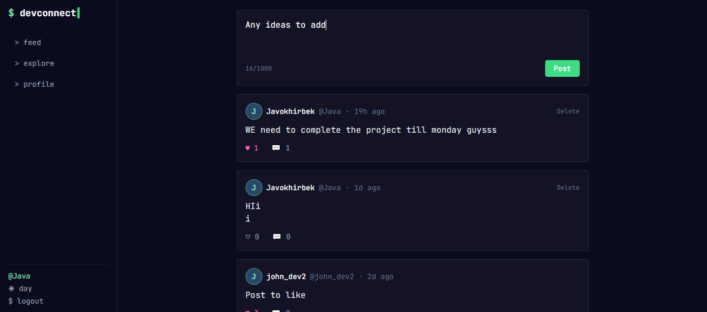
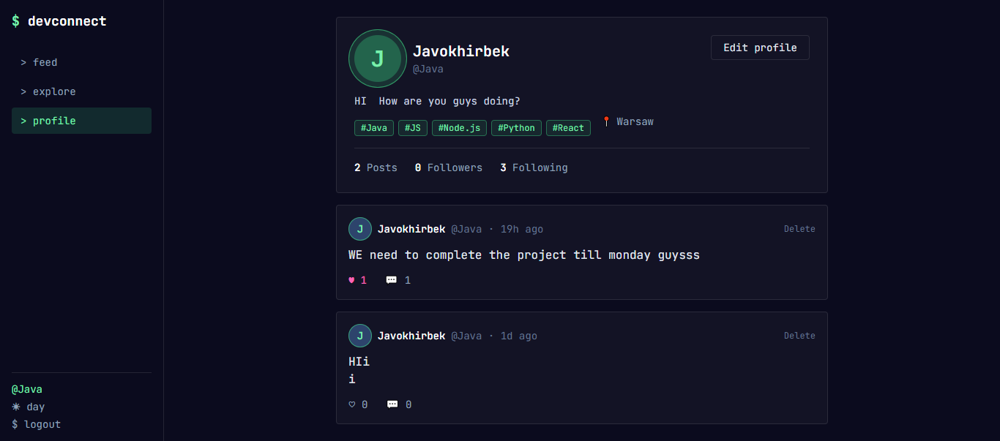
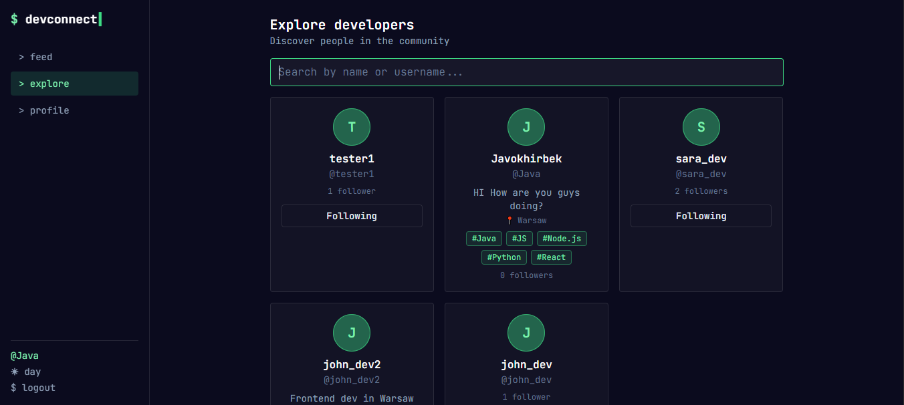
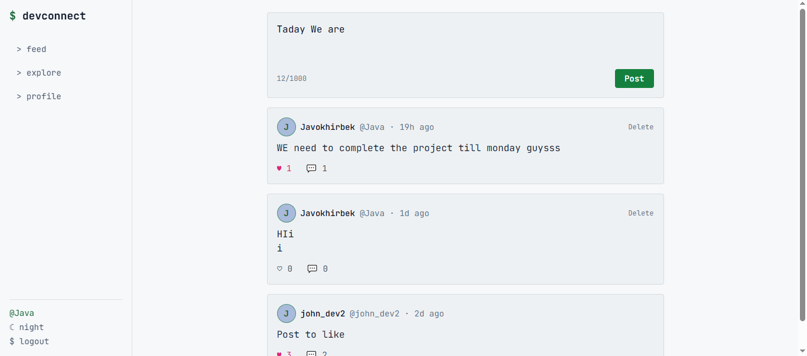
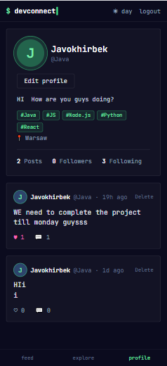

# DevConnect

A social platform for developers: share posts, follow people, and showcase your stack, with a monospace terminal-style UI.

**Live demo:** _coming soon_ · **Status:** Phase 1 complete, Phase 2 in planning


## Features

- **Authentication**: register, login and logout with JWT and bcrypt-hashed passwords
- **Social feed**: create and delete posts, likes (with optimistic UI), comments, cursor-based pagination
- **Developer profiles**: bio, location, GitHub and portfolio links, skills, follower and following counts
- **Follow system**: follow and unfollow developers
- **Search**: find developers by name or username, and posts by text
- **UI**: monospace terminal theme, day and night mode, responsive layout (sidebar on desktop, tab bar on mobile)

| Feed | Profile |
|---|---|
|  |  |

| Explore | Light mode | Mobile |
|---|---|---|
|  |  |  |

## Tech stack

| Layer | Technology |
|---|---|
| Frontend | React, Vite, React Router, Tailwind CSS, Axios |
| Backend | Node.js, Express 5 |
| Database | PostgreSQL with Prisma ORM |
| Auth and validation | JWT, bcrypt, Zod |

## Getting started

**Requirements:** Node.js 20 or newer and a running PostgreSQL server.

```bash
git clone https://github.com/Javokhir05/devconnect.git
cd devconnect
```

**Backend**

```bash
cd backend
npm install
cp .env.example .env        # on Windows: copy .env.example .env
# edit .env: set DATABASE_URL and a long random JWT_SECRET
npx prisma migrate dev      # creates the database tables
npx prisma generate
npm run dev                 # API on http://localhost:5000
```

**Frontend** (in a second terminal)

```bash
cd frontend
npm install
npm run dev                 # app on http://localhost:5173
```

## API overview

| Area | Endpoints |
|---|---|
| Auth | `POST /api/auth/register`, `POST /api/auth/login`, `GET /api/auth/me` |
| Posts | `GET /api/posts` (`?q=`, `?cursor=`), `GET /api/posts/:id`, `POST /api/posts`, `PATCH /api/posts/:id`, `DELETE /api/posts/:id` |
| Likes | `PUT /api/posts/:id/like`, `DELETE /api/posts/:id/like` |
| Comments | `GET` and `POST /api/posts/:id/comments`, `DELETE /api/comments/:id` |
| Users | `GET /api/users` (`?q=`), `GET /api/users/:username`, `GET /api/users/:username/posts`, `PATCH /api/users/me`, `PUT /api/users/me/skills` |
| Follow | `PUT` and `DELETE /api/users/:username/follow` |
| Skills | `GET /api/skills?q=` |

## Technical decisions

- **Ownership is enforced on the server.** The author of a post comes from the verified JWT, never from the request body, and edits and deletes check ownership.
- **Passwords are never returned.** Responses select only public fields.
- **Cursor pagination** keeps feeds fast and consistent as new posts arrive.
- **Composite primary keys** on likes, follows and user skills make duplicates impossible at the database level, and the endpoints are idempotent.
- **Input validation with Zod** runs before anything touches the database. Profile links are limited to http and https to prevent `javascript:` URLs.
- **Theming with CSS variables.** One set of tokens drives both the dark and light themes.

## Project structure

```
devconnect/
├── backend/    Express API, Prisma schema and migrations
└── frontend/   React app (pages, components, context, services)
```

## Roadmap

- [x] Phase 1: auth, posts, likes, comments, profiles, follow, search
- [ ] Phase 2: real-time chat (Socket.IO), notifications, image uploads, GitHub integration
- [ ] Phase 3: job board, admin dashboard, project showcase

## Author

[Javokhirbek Ruziboev] · [https://github.com/Javokhir05] · [roziboyevjavokhir045@gmail.com]
